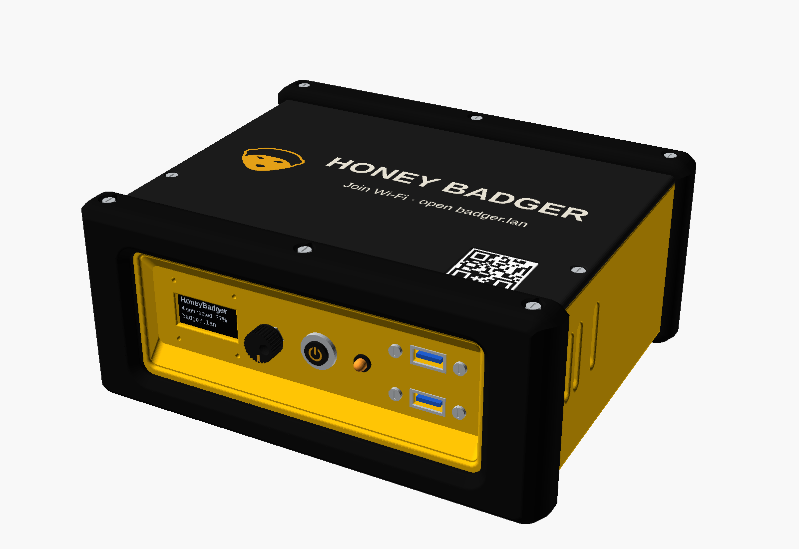
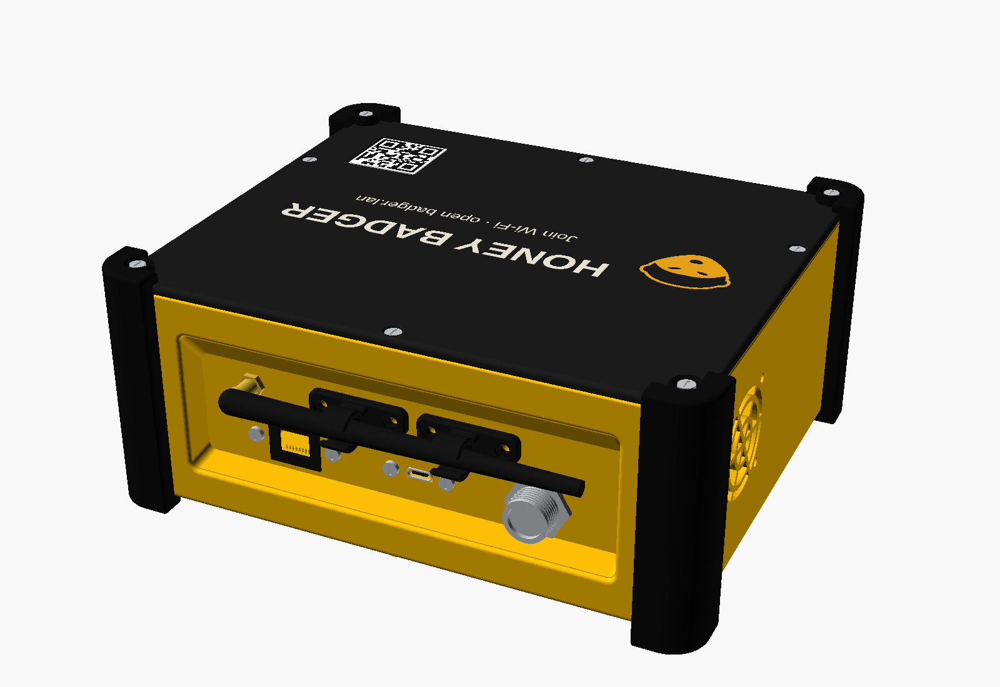
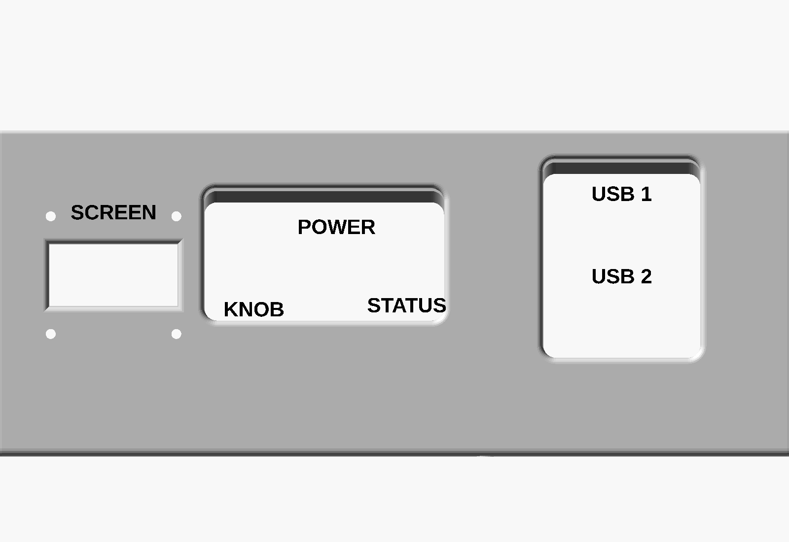
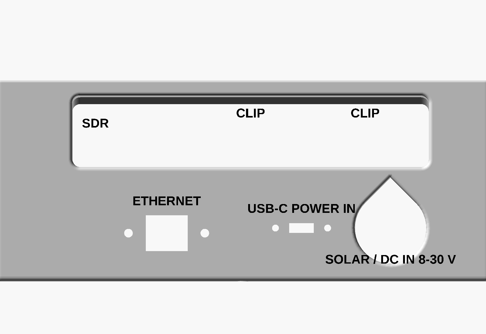

# How the Badger works

Honey Badger is a sealed box about the size of a big hardback book: 216 × 180 × 91 mm with its rubbery TPU bumpers. It makes its own Wi-Fi network. **Your phone, iPad or laptop is the screen.** Join its Wi-Fi, open a browser, and the whole library, maps, tools and offline AI are there, along with family and neighbourhood pages, the forecast, aircraft and weather-satellite pictures (see [FEATURES](FEATURES.md)).

The Badger also has a small screen, a knob and a power button of its own. With those you can check on it, show the Wi-Fi QR code, change power modes, run updates and shut it down, without a phone.





## Front panel



| Control | What it does |
|---|---|
| **Screen** (1.3″ OLED) | Cycles through: Wi-Fi name and how many people are connected · battery · address (`badger.lan`) · the time (Local, UTC or Nu:Time™ — your choice) · build or update progress · weather alerts. It goes dark after 45 s to save power; touch the knob to wake it |
| **Knob** (low-profile, in a recessed pocket with the power button and status light) | **Turn** to move through menus. **Press** to choose. **Hold 3 s** on the home screen to shut down (it asks first, and "No" is the default) |
| **Power button** | When off: **press** to start. When on: **press** for a clean shutdown. Holding it for about 10 s forces power off; only do that if it's frozen |
| **Status light** (red or amber) | **Solid**: ready · **slow blink**: downloading or updating · **medium blink**: on battery below 30 % · **fast blink**: weather alert |
| **USB 1, USB 2** (stacked in their own recessed pocket, USB 1 on top) | Plug in a USB stick and its files show up for everyone under *USB & Files*. Also used to import or export update bundles. Eject from the knob menu before pulling it out |

### Knob menu

```
Home (turn to flip pages · press for menu · hold 3 s to shut down)
├─ Join Wi-Fi (QR)      phones scan this to join; the whole password is printed beside it
├─ Open app (QR)        phones scan this to open badger.lan
├─ Invite member (QR)   a one-time family invite to scan (works once, for 24 h)               🔒
├─ Approve device (n)   a device the admin added to someone's name, waiting for a yes         🔒
│                       (only shown when there is one)
├─ Family radio         Channel link (QR) — scan with the Meshtastic app (holds the family key)
│                       Bluetooth PIN — of the Badger's radio, if the Badger changed it     🔒
├─ Status               battery %, time left, storage, temperature, users, pending updates, GPS fix (scroll with the knob)
├─ Sensors              alerts first ("!! Water 310 cm"), then readings — shown when sensors are connected
├─ Radio                weather radio listening / PAUSED, SDR 2 (aircraft / recording a satellite pass / missing),
│                       latest forecast, SDR 2 antenna: ADS-B whip · Satellite · Both
├─ Neighbourhood        aid station open/closed, missing people (names on the next page)
├─ Power mode           Endurance · Balanced · Full
├─ Services             AI · Courses · Mesh radio · Weather alerts — on/off                   🔒
├─ Updates              Check now · Download now · Import from USB 🔒 · Export to USB
├─ Time format          Local · UTC · Nu:Time™ (used everywhere on the screen)
├─ USB: eject
├─ Wi-Fi                Turn on · Turn off 🔒
└─ System               Restart 🔒 · Shut down 🔒 · Panel lock (set · change · turn off · lock now)
```

🔒 = asks for the **panel code** first, if you set one (it is off until you do). The code is 4–8
digits: turn the knob to pick a digit, press to add it, then choose *OK* (*Del* removes the last
digit, *Cancel* goes back). After the right code the panel stays open for 5 minutes, or until the
screen goes dark. Wrong codes make it wait longer and longer (up to an hour).

- **Setting a code:** in the app, Settings → Badger administration → *Set up panel code*; then,
  within 10 minutes, at the Badger: System → Panel lock → *Set a code*. Write down the 12-digit
  **recovery code** it shows and keep it with your recovery card.
- **Forgot the code?** On the code screen choose *Forgot?* and enter the recovery code. Or hold the
  knob down while the Badger starts: it opens the recovery screen directly. No recovery code
  either? At the console: `sudo python3 /opt/prepper/software/panel/panel.py --reset-lock`.
- *Join Wi-Fi* and *Open app* never ask for the code (the way onto the network); `[panel]
  lock_protect` in `prepper.toml` changes which entries ask.

## Rear panel



| Jack | Plug in | Notes |
|---|---|---|
| **USB-C power in** | any USB-C PD charger (45 W or more) or USB-C power bank | charges the internal battery while running |
| **Solar / DC in** (8–30 V) | a portable solar panel **directly** (e.g. Jackery SolarSaga, through a DC8020 adapter cable), a 12 V or 24 V battery, or a car socket | sealed screw-lock GX16, in a round well with room for your fingers on the lock ring. Each source gets its own adapter cable (DC8020, MC4, XT60, Anderson, car plug). Panel open-circuit voltage must be **30 V or less**. GX16 pin 1 is +, pin 2 is −; check new cables with a multimeter |
| **Ethernet** | your home router, for the first download and updates; or a laptop, during the build | not needed in everyday use |
| **SDR** (SMA) | folding VHF whip | receives NOAA Weather Radio alerts. The jack sits at the end of a recessed channel across the back. The whip **folds into the channel** and snaps into two clips when you're not using it or for transport. To use it, unfold it and tilt it back about 20° so it clears the top of the channel |
| **SDR 2** (SMA) | the small 1090 MHz whip (aircraft), or the coax from the outdoor 137 MHz V-dipole (weather satellites); one at a time | the second receiver, below the folded whip between the Ethernet and USB-C screws. Cap it when nothing is plugged in. Tell the Badger which antenna is on it on the Aircraft or Weather satellites page |
| **SENSORS** (M8, 4-pin) | outdoor sensors: waterproof temperature probe, flood float switch (see [features/sensors.md](features/sensors.md)) | IP67 screw-lock socket right of USB-C, deliberately a different connector from the power input. Keep its cap on when unused |

Wi-Fi, LoRa and GPS antennas are **built in** under the lid. Plastic doesn't block radio. The SDR whip is the only antenna outside, and nothing on the front or back stands out past the bumpers.

### Antennas

| Antenna | Where | Needed? |
|---|---|---|
| Wi-Fi ×2 | built in, under the lid, set apart and at right angles to each other | always connected |
| LoRa | built in, under the lid | always connected, so the radio can never run without an antenna. Secure its tiny U.FL plug with a dab of hot glue |
| GPS | built in, in a cradle under the lid, facing the sky | receive only. Works through the lid; may struggle deep indoors |
| SDR | external folding whip on the rear, the only one outside the case | receive only. Unfold it to get weather alerts; fold it into its channel otherwise |
| SDR 2 | on the SDR 2 jack when you use it: the 1090 MHz whip for aircraft, or the outdoor V-dipole on 3 m coax for satellites | only for aircraft and satellite pictures; weather alerts use SDR 1 |

## Sides, top and bottom

- **Left side:** 40 mm intake fan behind a grille, with a dust filter. Keep it clear.
- **Right side:** exhaust louvers that slope down toward the outside, so rain runs off.
- **Top (lid):**
  - a printed label with the Honey Badger mark and "Join Wi-Fi · open badger.lan" (or the same, printed into the lid in colour)
  - a square recess for a QR sticker (print the Wi-Fi QR shown on the screen)
  - 8 screws: 4 at the top of the corner bumpers and 4 along the edges
- **Bottom:** the bumpers' bottom caps are the feet.
- **Corners:** rounded TPU bumpers that wrap the corners, each screwed on at the top and the bottom with the screw heads sunk below the surface.
- **Opening the lid:** remove the 4 corner screws at the top of the bumpers and the 4 edge screws, flex the bumper tops aside and lift the lid. The bumpers can stay on: their bottom screws hold them to the base.

## Inside (lid off)

| What | Where |
|---|---|
| Raspberry Pi 5, UPS board with 4 battery cells underneath, NVMe SSD on top | screwed to a floating **sled** on four rubber dampers, held down by posts in the lid through a foam pad |
| Radio bay: SDR receiver, LoRa node, USB hub | zip-tied to anchors on the floor, right side; the LoRa node sits in the front-right corner |
| SDR 2 | on a printed shelf above the first SDR (two screws), its USB in the hub's 4th port and a short cable to the SDR 2 jack |
| Wi-Fi 6 adapter | standing on edge in a slot against the right wall; two short cables run up to the flex antennas under the lid |
| Wi-Fi, LoRa and GPS antennas | under the lid in raised locating frames and a GPS cradle, with zip-tie anchors for the cables. Lift the lid gently: the cables have a service loop |
| Solar/DC input electronics | on a small carrier plate in the front floor bay, under the screen |
| Rescue microSD | taped inside the lid. It boots the same system if the main drive ever fails |

## Everyday use

1. **Power.** Plug in USB-C or 12 V, or just run on the internal battery, and press the power button.
2. **Wait about a minute.** When the status light goes solid, it's ready.
3. **Join** your Badger's Wi-Fi (the name and password were set when it was built). Scan *Join Wi-Fi (QR)* on the Badger's screen, or pick it from your phone's Wi-Fi list.
4. **Open** **http://badger.lan.** Most phones pop it open by themselves after joining.
5. **Use it:**
   - **Search** everything from the top bar.
   - Browse **Medical, Survival, Maps…**
   - **Ask the Library** for an answer with sources.
   - Post on the **Check-in board**.
   - Open **Tools** for Morse, phrasebook, water dosing, radio frequencies, converter, sun and moon, and the Nu:Time™ clock.
   - Scroll down for the **Family**, **Neighbourhood**, **Radio & sky** and **More** pages (below).
6. **Turn off.** Press the power button once, or use the knob: System → Shut down. Never just pull power.

On an iPad or phone, *Add to Home Screen* makes it open like an app. See [OPERATIONS](OPERATIONS.md#phones-ipads-laptops).

### The launcher's home screen

At the top: quick buttons for **💬 Ask the library**, **⛑️ First aid & medical**, **🗺️ Open map** and **📋 Check-in board**, then a tile for each part of the library (Medical, Survival, Maps, Tools, USB & Files…). Below those, the feature pages, in four groups. Tiles marked **Family only** open only on a phone that joined the family with an invite code.

| Group | Tile | What it's for |
|---|---|---|
| **Family** | 🥫 Supplies *(Family only)* | water, food and medicine on hand: days left, expiry dates, low-stock warnings |
| | 🔐 Document vault *(Family only)* | locked, encrypted copies of IDs, insurance, medical papers and family photos |
| **Neighbourhood** | 🔎 Missing & found | missing people, found safe, lost & found items |
| | 🤝 Skills & resources | who nearby can help, and who needs help |
| | ⛑️ Aid station | station status for everyone, visit log for aid volunteers |
| | 🌡️ Sensors | temperature, water level, flood and radiation alerts |
| **Radio & sky** | 📻 NOAA forecast | the weather radio's forecast, written out |
| | ✈️ Aircraft | planes overhead, from their own radio broadcasts; also a layer on the map |
| | 🛰️ Weather satellites | pass times and pictures from Meteor-M weather satellites |
| **More** | 🎙️ Voice | ask out loud, hear the answer |

A group only appears when at least one of its features is switched on, so your Badger may show fewer tiles. Admin settings for each page are in a box at the bottom of that page, once you've unlocked admin mode under Settings. What each feature does and who can use it: [FEATURES](FEATURES.md).

## Power and battery

| Mode | What you get | Draw | On the internal battery |
|---|---|---:|---:|
| **Endurance** | everything except Courses and the video/book libraries; smaller, quicker AI; slowest CPU | ~4.5 W | ~10 h |
| **Balanced** (default) | everything you've enabled, normal AI | ~6.5 W | ~7 h |
| **Full** | everything at full speed, fan always on | 9–15 W | 3–5 h |

- **Charging:** the internal pack (≈ 50 Wh) charges whenever USB-C or the solar/DC input is connected. With the optional input meter, the screen and launcher show the watts coming in ("☀ 14 W").
- **Your 40 W panel:** on a sunny day it roughly covers Endurance around the clock (≈ 110 Wh/day). For Balanced, or cloudy weeks, use a bigger panel or add the 256 Wh LiFePO4 (Endurance then lasts about 2.5 days without sun).
- **Automatic switching:** below 30 % on battery it switches to Endurance by itself, and it shuts down cleanly at 6 %.
- **Details:** the full table of what's on in each mode, per-part power use and peaks is in [HARDWARE](HARDWARE.md#power-modes).

## Updates while it's running

The Badger can join your home Wi-Fi for updates: Settings → Badger administration → *Join a Wi-Fi network for updates*.

- **Two radios:** the built-in Wi-Fi joins your network while the USB Wi-Fi adapter keeps the hotspot up, so **everything keeps serving while it downloads**. Ethernet works the same way.
- **No interruptions:** new versions download in the background at low priority and swap in only when complete and verified. The one item being swapped pauses for about a second.

## Times everywhere

Every time on the Badger can show as **Local**, **UTC** or **Nu:Time™** (`GG:BB:TT`). That covers the clock, check-in board messages, alert expiry, update history, sunrise and sunset, and the front screen.

- **In the launcher:** tap the 🕒 clock in the bottom bar to switch, or set it in Settings → *Show times as*. Each phone keeps its own choice.
- **Badger-wide default:** the admin sets it in Settings → Badger administration.
- **On the front screen:** knob → Time format.

## What it can't do

The 1.3″ screen is for status, not reading. To read the library you need a phone, tablet or laptop. Any of them works; nothing needs to be installed.
